# A Gentle Introduction to Quantum Mechanics (lecture notes)

Recording: quantum-mechanics.mp4, 00:57:29. One speaker, followed by audience Q&A. Notes were written from the transcript and the slide stills. Where the speaker's words and the slide disagree, or the slide looks wrong, it is flagged in the section.

## Before the first slide (00:00:00)

A host introduces the speaker: a physics graduate who wants more people to understand quantum mechanics, because the theory is often misused by esoteric ideas. The speaker thanks the audience and warns that the "gentle introduction" may not stay gentle.

## Slide 1: Outline (00:01:20)

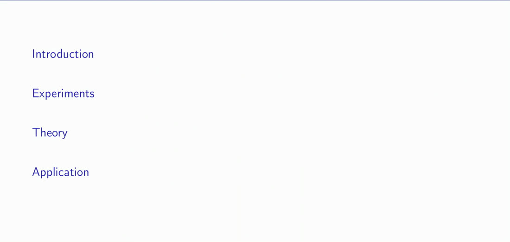

The agenda lists four parts: Introduction, Experiments, Theory, Application. The speaker begins with a short meta discussion about physical theories and the aim of the talk.

## Slide 2: Outline (00:01:28)

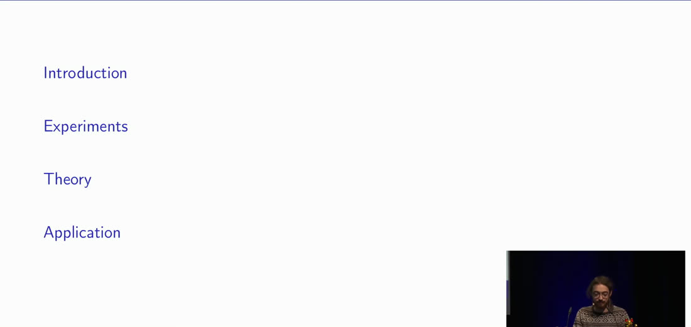

Same outline slide, now with the speaker's video inset. The speaker adds that most of the experiments are high-school physics. The theory part is where it "gets ugly": the equations of quantum mechanics are written down and made plausible. Applications come last.

## Slide 3: Concept of This Talk (00:01:56)

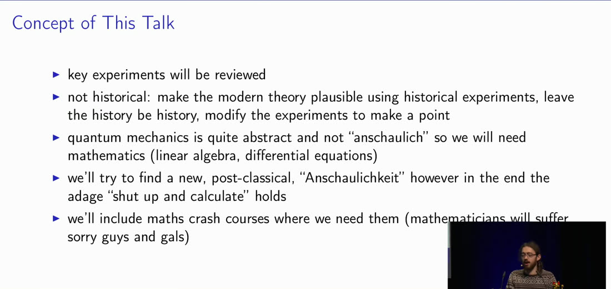

Transition frame of the next slide, with the inset still visible. Content is identical to Slide 4.

## Slide 4: Concept of This Talk (00:01:58)

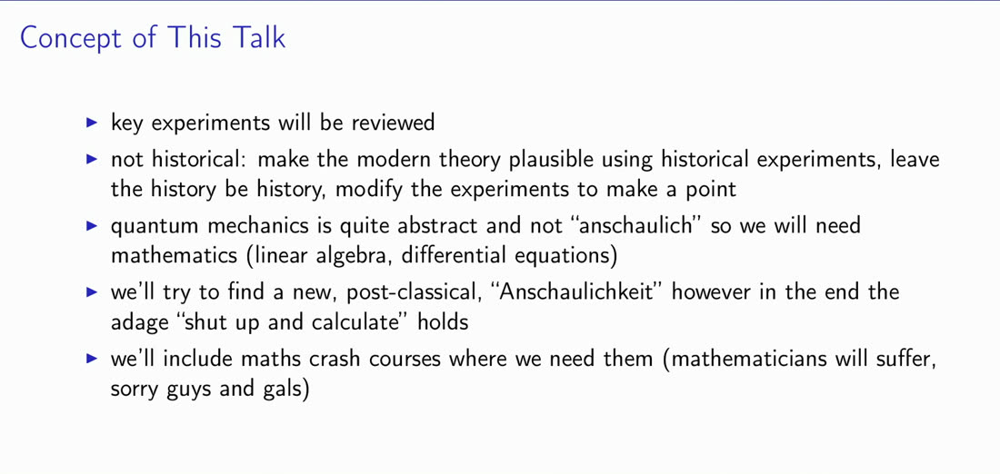

The slide lists the talk's principles:
- review the key experiments;
- not historical: make the modern theory plausible from historical experiments, and modify the experiments to make a point;
- quantum mechanics is abstract and not "anschaulich" (intuitive, visualisable), so mathematics is needed (linear algebra, differential equations);
- look for a new, post-classical "Anschaulichkeit", though in the end "shut up and calculate" holds;
- include maths crash courses where needed.

The speaker added that much of quantum mechanics is "linear algebra on steroids", meaning in infinite dimensions, and apologised to mathematicians because he will "lie a lot".

## Slide 5: How Scientific Theories Work (00:02:58)

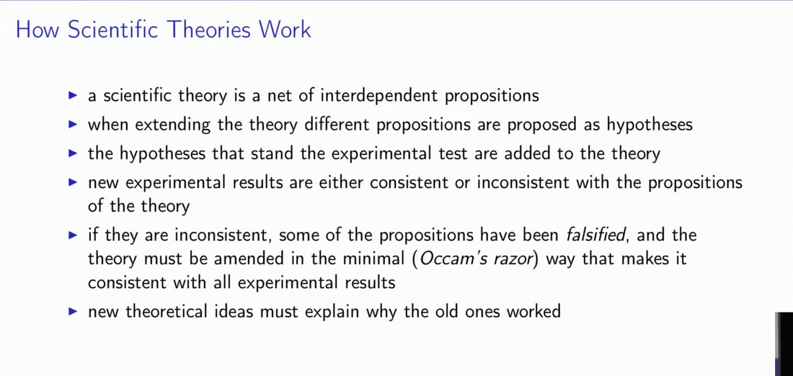

The slide describes a theory as a net of interdependent propositions:
- extensions are proposed as hypotheses;
- hypotheses that pass experimental tests are added;
- results that are inconsistent with the theory falsify some propositions, and the theory must then be amended minimally (Occam's razor);
- a new theory must explain why the old one worked.

The speaker added examples: $F=ma$ and Newtonian gravitation as propositions of classical mechanics. He credited falsification to Popper: a theory is scientific if it can be falsified, a theory can never be proven true, and what has not been refuted is an approximation to truth. He compared Occam's razor to the "principle of least surprise" in software engineering. The old theory must be contained in the new one in some limit (Newtonian mechanics worked for 200 years).

Spoken: the two propositions as formulas.

$$F = m a$$

$$F = G\,\frac{m_1 m_2}{r^2}$$

## Slide 6: How It All Began (00:05:18)

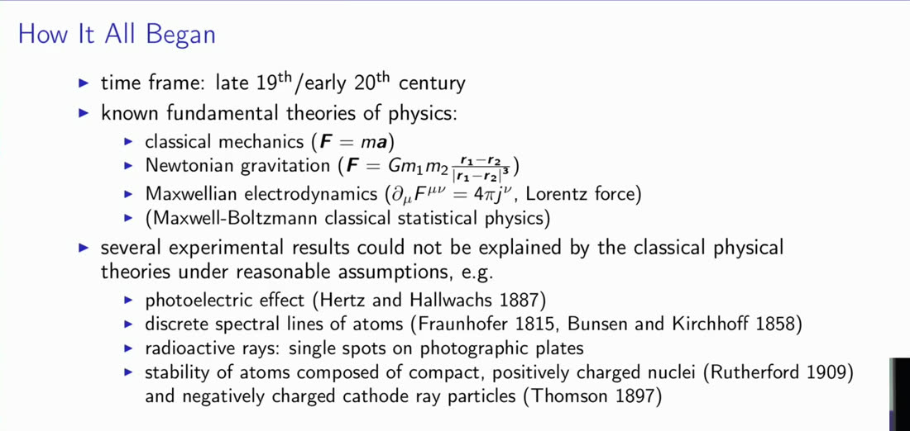

Late 19th and early 20th century. The known fundamental theories were classical mechanics, Newtonian gravitation, Maxwell electrodynamics (with the Lorentz force) and, in brackets, Maxwell-Boltzmann statistical physics. Experimental results that classical theory could not explain, under reasonable assumptions:
- photoelectric effect (Hertz and Hallwachs, 1887);
- discrete spectral lines of atoms (Fraunhofer 1815, Bunsen and Kirchhoff 1858);
- radioactive rays, seen as single spots on photographic plates;
- stability of atoms made of compact positive nuclei (Rutherford 1909) and negative cathode-ray particles (Thomson 1897).

The speaker added a description of vacuum tubes and the cathode-ray experiment. A heated electrode emits electrons into the vacuum, a positively charged plate with a pinhole accelerates them into a beam, and a little residual gas makes the beam glow. Magnetic and electric fields deflect the beam, so the carriers are negatively charged particles. Since atoms are neutral, they must also contain a positive component. He called classical statistical physics "a pain".

The slide shows these equations (the speaker called the Maxwell one "this funny equation"):

$$F = m a$$

$$\mathbf{F} = G m_1 m_2 \frac{\mathbf{r}_1 - \mathbf{r}_2}{|\mathbf{r}_1 - \mathbf{r}_2|^3}$$

$$\partial_\mu F^{\mu\nu} = 4\pi j^\nu$$

## Slide 7: Rutherford(-Marsden-Geiger) Experiment (00:09:06)

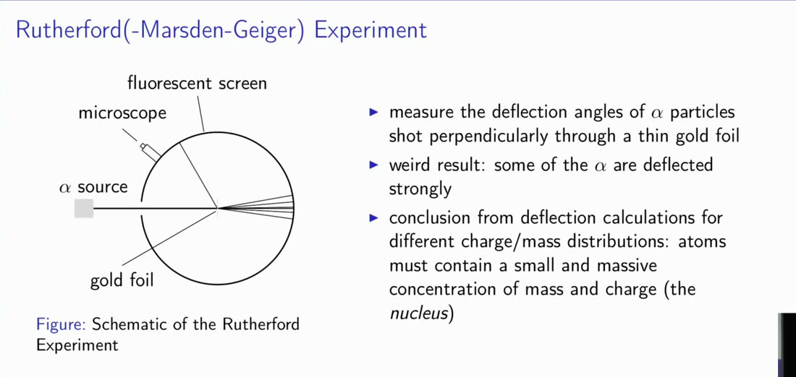

The figure shows an $\alpha$ source, a thin gold foil, a fluorescent screen and a microscope. The $\alpha$ particles are shot perpendicularly through the foil and the deflection angles are measured. Some are deflected strongly. Comparing deflection calculations for different charge and mass distributions, the atom must contain a small, massive concentration of mass and charge: the nucleus.

The speaker added that Rutherford had the idea and Marsden and Geiger did the experimental work. Gold can be hammered into foil only a few hundred atoms thick. The $\alpha$ particles are helium nuclei from radioactive decay, for example of uranium isotopes. A "plum pudding" with spread-out charge could not give such deflections. Rutherford first imagined orbiting electrons around the nucleus.

## Slide 8: Atoms Are Stable!? (00:10:33)

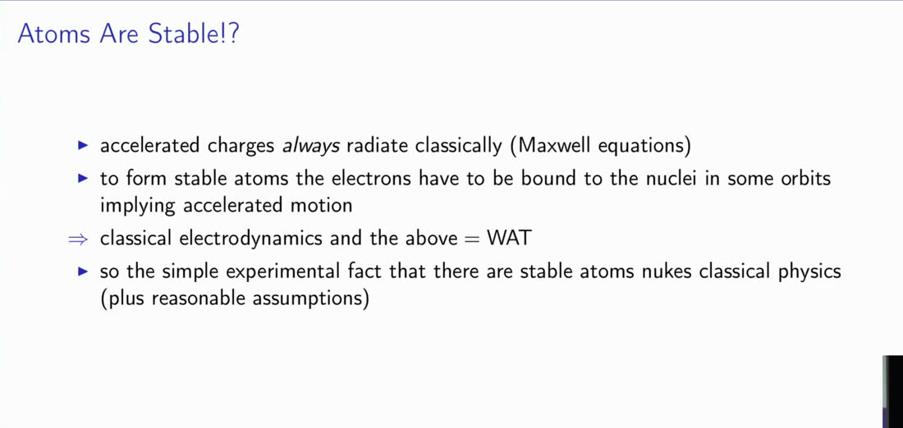

Accelerated charges always radiate classically (Maxwell). Stable atoms need electrons bound to nuclei in orbits, which implies acceleration. Classical electrodynamics plus this gives a contradiction ("WAT"). So the simple fact that atoms are stable "nukes" classical physics (plus reasonable assumptions). The speaker said it was completely clear at this point that classical physics as known was wrong.

## Slide 9: Photoelectric Effect (00:11:07)

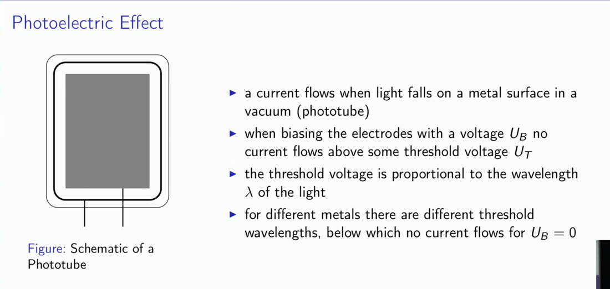

The figure is a schematic of a phototube. Current flows when light falls on a metal surface in a vacuum. With a bias voltage $U_B$ across the electrodes, no current flows above a threshold voltage $U_T$. For different metals there are different threshold wavelengths, below which no current flows at $U_B = 0$.

Flag: the slide says the threshold voltage is proportional to the wavelength $\lambda$ of the light. The speaker said it is proportional to the frequency and not to the intensity. These are not the same statement; the slide's wording looks like a slip, since the stopping voltage grows with frequency. The speaker added that this surprised people because frequency should not matter for energy, and that it led Einstein to the idea of energy portions ("quanta") in the field.

## Slide 10: Spectral Lines of Atoms, Experimental Setup (00:12:31)

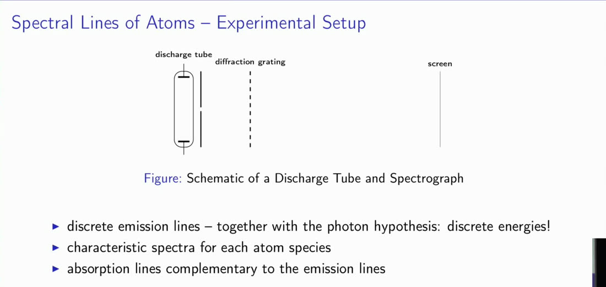

The figure shows a discharge tube, a diffraction grating and a screen. A high voltage across a thin gas excites the atoms, which relax and emit light at sharp frequencies. The grating separates the light by wavelength. The slide says: discrete emission lines, together with the photon hypothesis, mean discrete energies; each atom species has a characteristic spectrum; absorption lines are complementary to emission lines. The speaker mentioned Bunsen and Kirchhoff's precision measurements.

## Slide 11: Davisson-Germer Experiment (00:13:31)

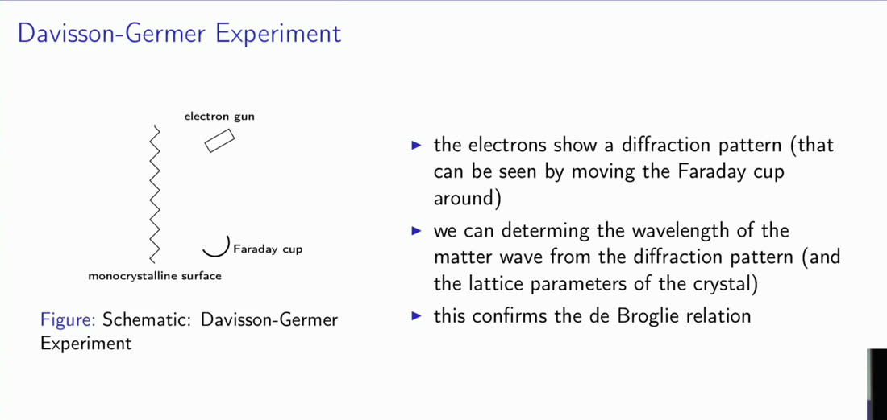

The figure shows an electron gun, a monocrystalline surface and a Faraday cup. Moving the cup around reveals a diffraction pattern of the electrons. The wavelength of the "matter wave" can be determined from the pattern and the crystal's lattice parameters. This confirms the de Broglie relation. The speaker stressed how odd it was that "little hard balls" show interference, like a crystal acting as a diffraction grating.

## Slide 12: Radioactivity and Experiments with Single Particles (00:14:14)

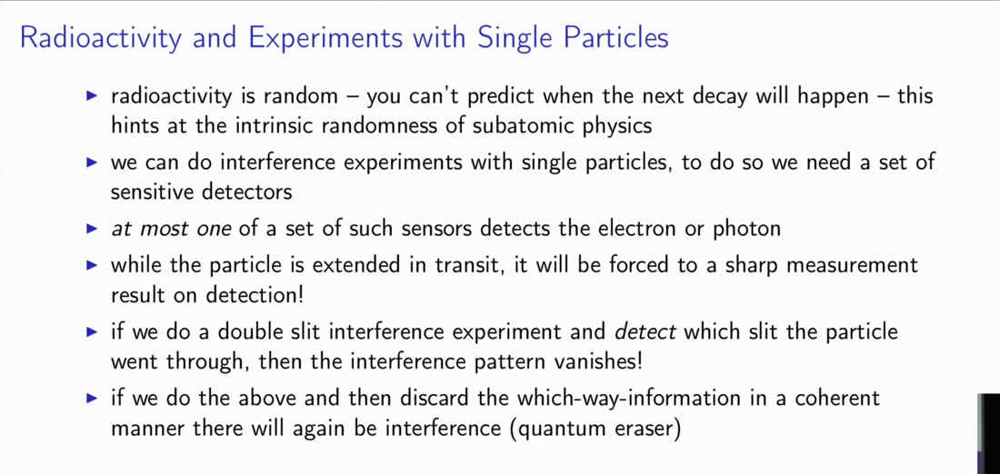

The slide says:
- radioactivity is random: the next decay cannot be predicted, which hints at intrinsic randomness;
- interference experiments can be done with single particles using sensitive detectors;
- at most one of a set of sensors detects the particle;
- the particle is extended in transit but forced to a sharp result when detected;
- detecting which slit the particle went through in a double slit makes the interference vanish;
- discarding the which-way information coherently brings interference back (quantum eraser).

The speaker called these "modern facts" needed later: a single particle registers at one place only, yet many particles build up an interference pattern.

## Slide 13: Crash Course: Complex Numbers (00:15:44)

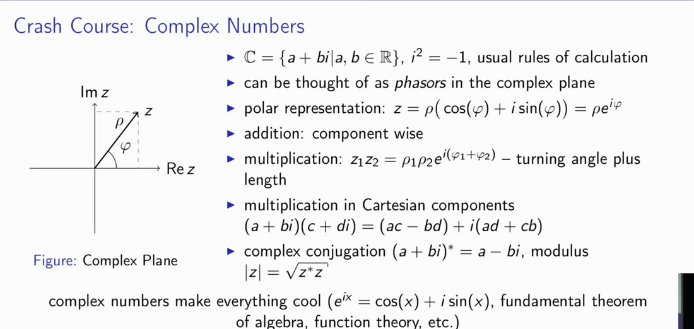

Cross-fade frame into the complex-numbers slide; see Slide 14 for the content.

## Slide 14: Crash Course: Complex Numbers (00:15:49)

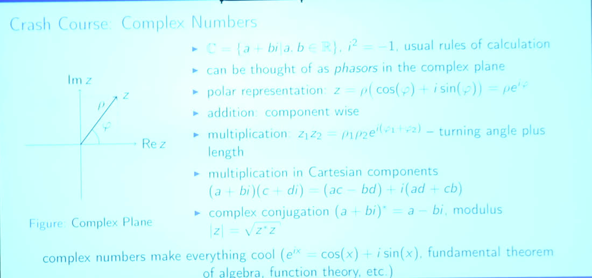

The figure shows the complex plane with modulus $\rho$ and angle $\varphi$. The slide gives the definition, the polar form, addition (component-wise), multiplication (angles add, lengths multiply), the Cartesian product formula, and conjugation with the modulus. It closes with "complex numbers make everything cool" (Euler's formula, the fundamental theorem of algebra, function theory).

$$\mathbb{C} = \{a + bi \mid a, b \in \mathbb{R}\}, \quad i^2 = -1$$

$$z = \rho\left(\cos\varphi + i\sin\varphi\right) = \rho\, e^{i\varphi}$$

$$z_1 z_2 = \rho_1 \rho_2\, e^{i(\varphi_1 + \varphi_2)}$$

$$(a + bi)(c + di) = (ac - bd) + i(ad + cb)$$

$$(a + bi)^* = a - bi, \qquad |z| = \sqrt{z^* z}$$

$$e^{ix} = \cos x + i \sin x$$

The speaker added two facts: an algebraic equation has exactly as many complex solutions as its degree (counted correctly), and a complex function that is differentiable once is differentiable infinitely often.

## Slide 15: Crash Course: Vector Spaces (00:16:51)

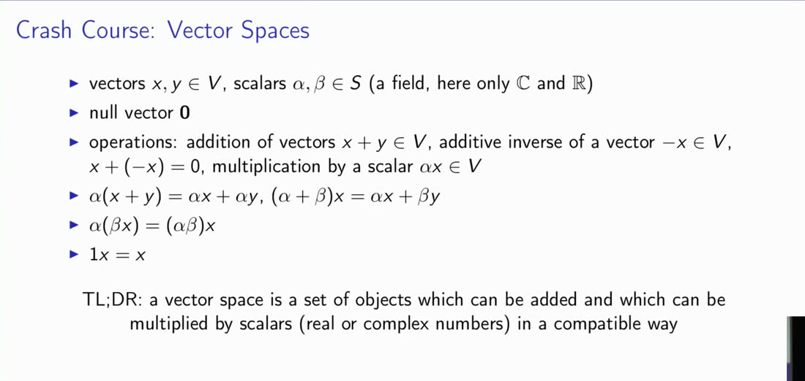

A vector space has vectors $x, y \in V$ and scalars $\alpha, \beta$ from a field (here only $\mathbb{C}$ and $\mathbb{R}$), a null vector, addition, additive inverses and scalar multiplication, with the usual compatibility laws. TL;DR on the slide: a set of objects that can be added and multiplied by scalars in a compatible way.

$$x + (-x) = 0$$

$$\alpha(x + y) = \alpha x + \alpha y, \qquad (\alpha + \beta)x = \alpha x + \beta y$$

$$\alpha(\beta x) = (\alpha\beta)x, \qquad 1x = x$$

Flag: the slide prints $(\alpha+\beta)x = \alpha x + \beta y$; the last term is presumably meant to be $\beta x$. It is transcribed as shown.

## Slide 16: Crash Course: $L^2$ Space (00:17:30)

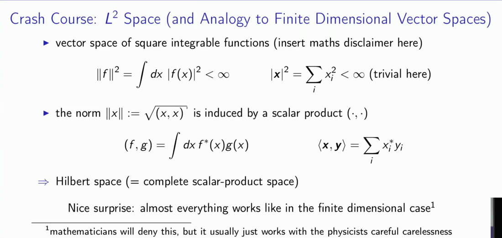

The slide compares the space of square-integrable functions with finite-dimensional vectors. A function's value at each point plays the role of a vector component. The norm is induced by a scalar product, the asterisk is complex conjugation, and the result is a Hilbert space (a complete scalar-product space). The slide's moral: almost everything works as in finite dimensions, and a footnote says mathematicians will deny it but it works with "the physicists' careful carelessness".

$$\|f\|^2 = \int dx\, |f(x)|^2 < \infty \qquad\qquad |\mathbf{x}|^2 = \sum_i x_i^2 < \infty$$

$$\|x\| := \sqrt{(x, x)}$$

$$(f, g) = \int dx\, f^*(x)\, g(x) \qquad\qquad \langle \mathbf{x}, \mathbf{y} \rangle = \sum_i x_i^* y_i$$

The speaker added that diagonalising matrices with suitable properties carries over to this setting.

## Slide 17: Modelling the Wave-like Behaviour of Particles (00:19:45)

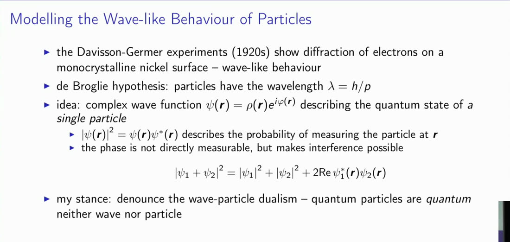

The Davisson-Germer experiments (1920s, nickel surface) show electron diffraction. de Broglie hypothesised a wavelength $\lambda = h/p$. The model: a complex wave function describes the state of a single particle. $|\psi|^2$ is the probability density of measuring the particle at $\mathbf{r}$. The phase is not directly measurable but makes interference possible.

$$\lambda = \frac{h}{p}$$

$$\psi(\mathbf{r}) = \rho(\mathbf{r})\, e^{i\varphi(\mathbf{r})}$$

$$|\psi(\mathbf{r})|^2 = \psi(\mathbf{r})\psi^*(\mathbf{r})$$

$$|\psi_1 + \psi_2|^2 = |\psi_1|^2 + |\psi_2|^2 + 2\,\mathrm{Re}\,\psi_1^*(\mathbf{r})\psi_2(\mathbf{r})$$

The speaker added that de Broglie's relation was proposed before the experiments confirmed it, motivated by Bohr's atom. His stance (on the slide too): reject "wave-particle duality"; quantum objects are just quantum, neither wave nor particle.

## Slide 18: States of Definite Momentum (00:21:41)

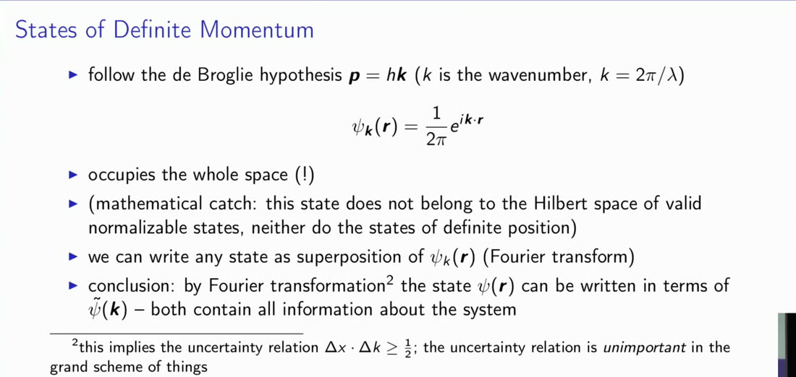

Following de Broglie, $\mathbf{p} = h\mathbf{k}$ with wavenumber $k = 2\pi/\lambda$. A plane wave describes definite momentum and occupies the whole space. The catch: it is not normalisable, so it is not in the Hilbert space (neither are states of definite position). Any state can be written as a superposition of plane waves (Fourier transform), so $\psi(\mathbf{r})$ and $\tilde\psi(\mathbf{k})$ carry the same information.

$$\psi_{\mathbf{k}}(\mathbf{r}) = \frac{1}{2\pi}\, e^{i\mathbf{k}\cdot\mathbf{r}}$$

$$\Delta x \cdot \Delta k \geq \frac{1}{2}$$

The inequality is in a footnote: the uncertainty relation follows from Fourier transformation, and the slide calls it unimportant "in the grand scheme of things". The speaker said a function cannot be concentrated in both position and momentum space.
## Slide 19: Operators (00:23:02)

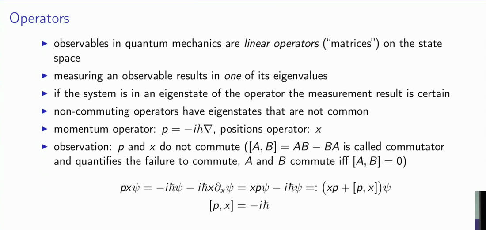

Observables are linear operators ("matrices") on the state space. Measuring an observable gives one of its eigenvalues. If the system is in an eigenstate, the result is certain. Non-commuting operators have no common eigenstates. Examples: momentum $p = -i\hbar\nabla$ and position $x$ (multiplication). The commutator measures failure to commute.

$$[A, B] = AB - BA$$

$$p\,x\,\psi = -i\hbar\psi - i\hbar\, x\,\partial_x \psi = x\,p\,\psi - i\hbar\psi =: (xp + [p, x])\,\psi$$

$$[p, x] = -i\hbar$$

The speaker explained that the commutator vanishes exactly when $AB = BA$.

## Slide 20: More on Operators (00:25:13)

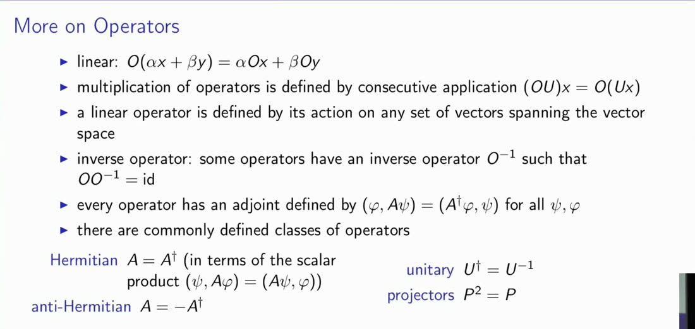

Operators are linear, multiply by consecutive application, and are determined by their action on any spanning set. Some have inverses. Every operator has an adjoint defined through the scalar product. Common classes: Hermitian, anti-Hermitian, unitary, projectors.

$$O(\alpha x + \beta y) = \alpha\, Ox + \beta\, Oy$$

$$(OU)x = O(Ux)$$

$$O\,O^{-1} = \mathrm{id}$$

$$(\varphi, A\psi) = (A^\dagger \varphi, \psi) \quad \text{for all } \psi, \varphi$$

$$\text{Hermitian: } A = A^\dagger \quad \big((\psi, A\varphi) = (A\psi, \varphi)\big)$$

$$\text{anti-Hermitian: } A = -A^\dagger$$

$$\text{unitary: } U^\dagger = U^{-1}$$

$$\text{projector: } P^2 = P$$

The speaker added that the scalar product is conjugate-linear in its first argument ("sesquilinear"), and that unitary operators generalise rotations, whose transpose is their inverse.

## Slide 21: Expectation Values (00:26:50)

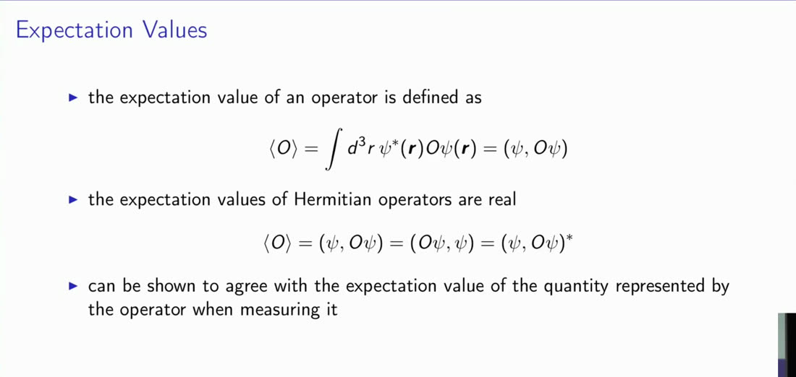

The expectation value of an operator is defined by an integral. For Hermitian operators it is real. It can be shown to agree with the average of repeated measurements of the corresponding quantity.

$$\langle O \rangle = \int d^3 r\, \psi^*(\mathbf{r})\, O\, \psi(\mathbf{r}) = (\psi, O\psi)$$

$$\langle O \rangle = (\psi, O\psi) = (O\psi, \psi) = (\psi, O\psi)^*$$

The speaker said that at this point the definition is just a formula, and that later it is justified as the mean of the random results when a system is prepared identically each time. He then began the eigenvalue crash course: $A\psi = \lambda\psi$, with scalar multiples of an eigenvector also eigenvectors, and the possibility that one eigenvalue has a higher-dimensional eigenspace. Hermitian operators have real eigenvalues (spoken).

$$A\psi = \lambda\psi$$

## Slide 22: Crash Course: Eigenvalue Problems (cont.) (00:28:31)

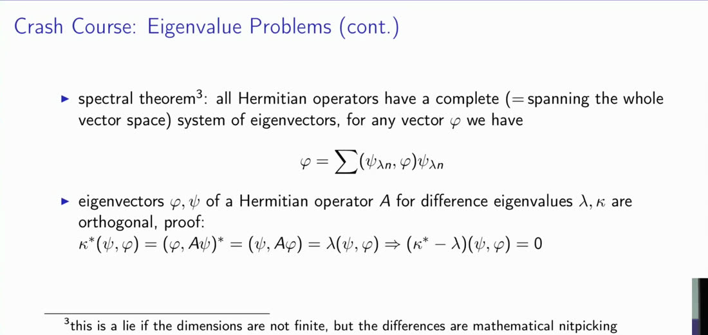

Spectral theorem: a Hermitian operator has a complete system of eigenvectors, so any vector $\varphi$ can be expanded in them. Eigenvectors of different eigenvalues are orthogonal; the slide gives the proof. A footnote says the theorem is a lie in infinite dimensions, but the differences are "mathematical nitpicking".

$$\varphi = \sum_n (\psi_{\lambda_n}, \varphi)\, \psi_{\lambda_n}$$

$$\kappa^*(\psi, \varphi) = (\varphi, A\psi)^* = (\psi, A\varphi) = \lambda(\psi, \varphi) \;\Rightarrow\; (\kappa^* - \lambda)(\psi, \varphi) = 0$$

The speaker added that this allows an orthonormal basis, normalised to length one because of the probability interpretation. He then turned to time evolution.

## Slide 23: Equation of Motion, Requirements (00:29:45)

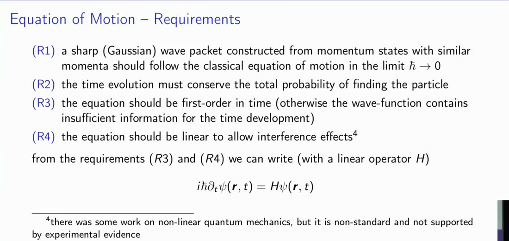

Four requirements:
- (R1) a sharp (Gaussian) wave packet built from similar momenta follows the classical equation of motion in the limit $\hbar \to 0$;
- (R2) the evolution conserves the total probability;
- (R3) first order in time, otherwise the wave function lacks the information for time development;
- (R4) linear, to allow interference. A footnote says non-linear quantum mechanics exists but is non-standard and not supported by experiment.

(R3) and (R4) together give, with a linear operator $H$:

$$i\hbar\, \partial_t \psi(\mathbf{r}, t) = H \psi(\mathbf{r}, t)$$

The speaker said the factor $i\hbar$ is convention, "we just wanted that there".

## Slide 24: Equation of Motion, Conservation of Probability (00:31:33)

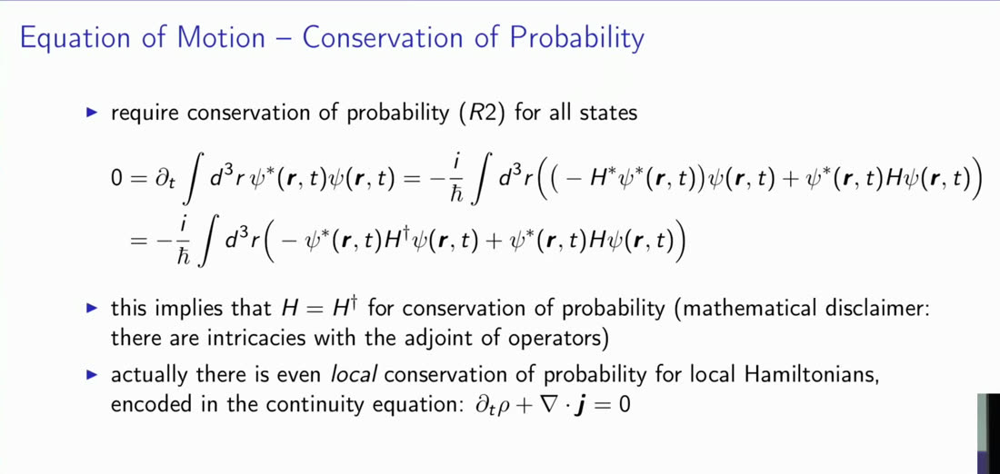

Requiring (R2) for all states leads to $H = H^\dagger$ (with a caveat about subtleties of operator adjoints). For local Hamiltonians there is even local conservation of probability, expressed by the continuity equation.

$$0 = \partial_t \int d^3 r\, \psi^*(\mathbf{r}, t)\psi(\mathbf{r}, t) = -\frac{i}{\hbar}\int d^3 r \Big( \big(-H^*\psi^*(\mathbf{r}, t)\big)\psi(\mathbf{r}, t) + \psi^*(\mathbf{r}, t)\, H\psi(\mathbf{r}, t) \Big)$$

$$= -\frac{i}{\hbar}\int d^3 r \Big( -\psi^*(\mathbf{r}, t)\, H^\dagger \psi(\mathbf{r}, t) + \psi^*(\mathbf{r}, t)\, H\psi(\mathbf{r}, t) \Big)$$

$$H = H^\dagger$$

$$\partial_t \rho + \nabla \cdot \mathbf{j} = 0$$

The speaker described local conservation as: a particle cannot vanish here and appear there, it must flow.

## Slide 25: The Hamiltonian (00:32:13)

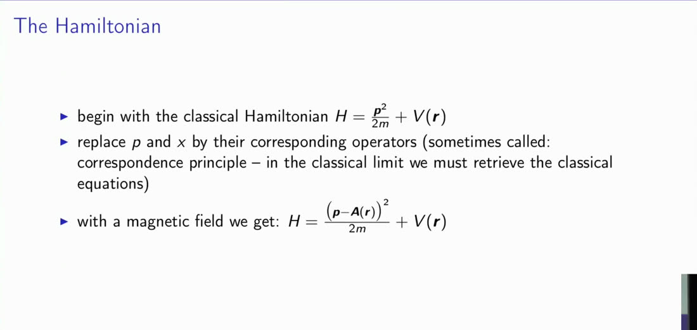

Start from the classical Hamiltonian and replace $p$ and $x$ by operators (the correspondence principle: the classical limit must reproduce the classical equations). With a magnetic field, $\mathbf{p}$ is replaced by $\mathbf{p} - \mathbf{A}$.

$$H = \frac{\mathbf{p}^2}{2m} + V(\mathbf{r})$$

$$H = \frac{\left(\mathbf{p} - \mathbf{A}(\mathbf{r})\right)^2}{2m} + V(\mathbf{r})$$

The speaker went on to the Ehrenfest theorem, which is not on this still (the equations were said while this slide was up). They are almost Newton's laws for the expectation values. The velocity is momentum over mass, but the force is averaged ($\langle\nabla V\rangle$), not evaluated at the mean position, so the equations do not close in general. For a sharply peaked wave packet the classical equations are recovered, which explains why the old theory worked. Why massive objects are usually well localised is "a question we're still having trouble with today". (Spoken):

$$\frac{d}{dt}\langle \mathbf{r} \rangle = \frac{\langle \mathbf{p} \rangle}{m}$$

$$\frac{d}{dt}\langle \mathbf{p} \rangle = -\langle \nabla V \rangle$$

## Slide 26: Solving the Schrödinger Equation (00:34:12)

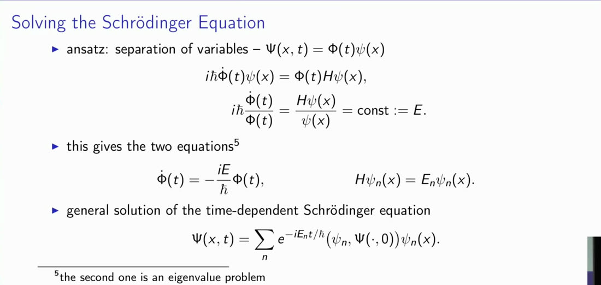

Separation of variables $\Psi(x,t) = \Phi(t)\psi(x)$ gives a time equation and an eigenvalue problem for $H$. Any initial state expands in the energy eigenfunctions, giving the general solution.

$$\Psi(x, t) = \Phi(t)\psi(x)$$

$$i\hbar\,\dot\Phi(t)\,\psi(x) = \Phi(t)\, H\psi(x)$$

$$i\hbar\,\frac{\dot\Phi(t)}{\Phi(t)} = \frac{H\psi(x)}{\psi(x)} = \text{const} := E$$

$$\dot\Phi(t) = -\frac{iE}{\hbar}\,\Phi(t), \qquad H\psi_n(x) = E_n\psi_n(x)$$

$$\Psi(x, t) = \sum_n e^{-iE_n t/\hbar}\,\big(\psi_n, \Psi(\cdot, 0)\big)\,\psi_n(x)$$

The speaker noted that an energy eigenstate keeps its shape and only its phase changes, at a rate set by the energy.

## Slide 27: Measurement, or How I Measured My Cat and Now It's Dead (00:35:06)

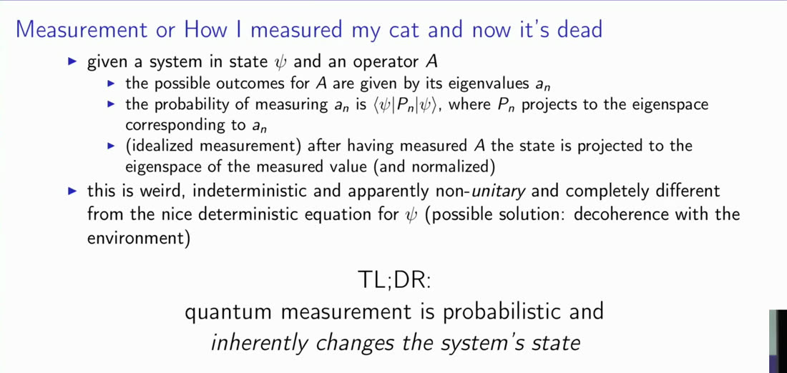

For a system in state $\psi$ and an operator $A$: the possible outcomes are the eigenvalues $a_n$; the probability of $a_n$ is $\langle\psi|P_n|\psi\rangle$, where $P_n$ projects onto the corresponding eigenspace; after an idealised measurement the state is projected onto that eigenspace and normalised. This is indeterministic and apparently non-unitary, unlike the Schrödinger equation (possible resolution: decoherence with the environment). TL;DR on the slide: quantum measurement is probabilistic and inherently changes the system's state.

$$p(a_n) = \langle \psi | P_n | \psi \rangle$$

The speaker used Schrödinger's cat as the illustration: the cat is in a superposition until the box is opened.

## Slide 28: Crash Course: Tensor Product (00:35:41)

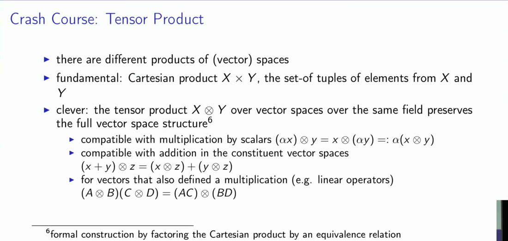

The speaker skipped the multi-particle material ("I'll skip the multi-particle things") and passed over this slide in two seconds. It defines the tensor product $X \otimes Y$ of vector spaces over the same field, as opposed to the Cartesian product $X \times Y$, and keeps the vector space structure. A footnote says the formal construction factors the Cartesian product by an equivalence relation.

$$(\alpha x) \otimes y = x \otimes (\alpha y) =: \alpha(x \otimes y)$$

$$(x + y) \otimes z = (x \otimes z) + (y \otimes z)$$

$$(A \otimes B)(C \otimes D) = (AC) \otimes (BD)$$

## Slide 29: Multiple Particles (00:35:43)

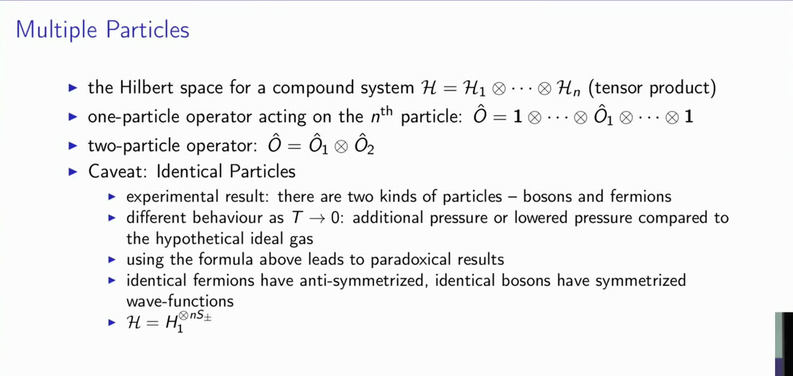

A compound system lives in the tensor product of the single-particle Hilbert spaces. One-particle operators act on one factor, with the identity elsewhere. Caveat: identical particles come as bosons and fermions, which behave differently as $T \to 0$ (extra or reduced pressure compared with an ideal gas). The naive product formula gives paradoxical results; identical fermions have anti-symmetrised wave functions and identical bosons symmetrised ones.

$$\mathcal{H} = \mathcal{H}_1 \otimes \cdots \otimes \mathcal{H}_n$$

$$\hat O = \mathbf{1} \otimes \cdots \otimes \hat O_1 \otimes \cdots \otimes \mathbf{1}$$

$$\hat O = \hat O_1 \otimes \hat O_2$$

$$\mathcal{H} = H_1^{\otimes n S_\pm}$$

The last line is transcribed as it appears; its exact notation is small and hard to read in the still.

## Slide 30: Summary: The Axioms of Quantum Mechanics (00:35:46)

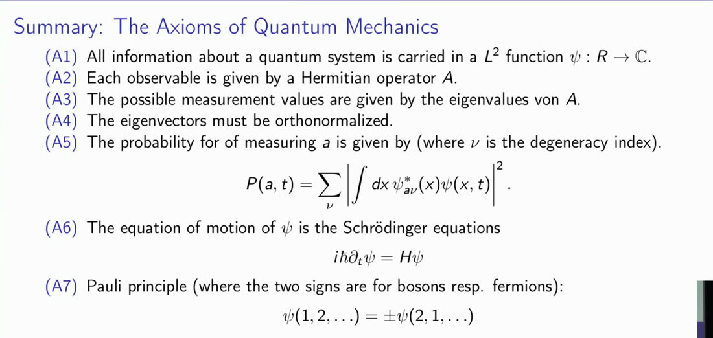

The speaker called this a summary of everything so far and told the audience not to read it in detail.
- (A1) All information about a quantum system is carried in an $L^2$ function $\psi: \mathbb{R} \to \mathbb{C}$.
- (A2) Each observable is a Hermitian operator $A$.
- (A3) The possible measurement values are the eigenvalues of $A$.
- (A4) The eigenvectors must be orthonormalised.
- (A5) The probability of measuring $a$ is given by the formula below ($\nu$ is the degeneracy index).
- (A6) The equation of motion is the Schrödinger equation.
- (A7) The Pauli principle (signs for bosons and fermions respectively).

$$P(a, t) = \sum_\nu \left| \int dx\, \psi_{a\nu}^*(x)\, \psi(x, t) \right|^2$$

$$i\hbar\, \partial_t \psi = H\psi$$

$$\psi(1, 2, \ldots) = \pm\,\psi(2, 1, \ldots)$$

The speaker singled out A7: the wave function changes sign when two identical fermions are exchanged, and this is what makes atoms stable.

## Slide 31: How Not to Be Afraid of the Dirac (or Bra-Ket) Notation (00:36:21)

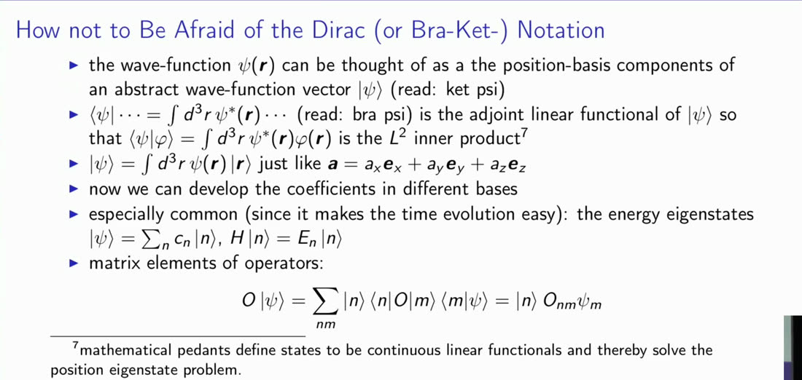

The wave function $\psi(\mathbf{r})$ is the position-basis component of an abstract vector $|\psi\rangle$, the ket. The bra $\langle\psi|$ is its adjoint linear functional, so $\langle\psi|\varphi\rangle$ is the $L^2$ inner product. The ket expands over position states like a vector over $\mathbf{e}_x, \mathbf{e}_y, \mathbf{e}_z$, and the coefficients can be expressed in other bases. Energy eigenstates are especially common because they make time evolution easy. A footnote notes that pedants define states as continuous linear functionals, which solves the position-eigenstate problem.

$$\langle\psi|\cdots = \int d^3 r\, \psi^*(\mathbf{r})\cdots$$

$$\langle\psi|\varphi\rangle = \int d^3 r\, \psi^*(\mathbf{r})\varphi(\mathbf{r})$$

$$|\psi\rangle = \int d^3 r\, \psi(\mathbf{r})\,|\mathbf{r}\rangle \quad \text{just like} \quad \mathbf{a} = a_x \mathbf{e}_x + a_y \mathbf{e}_y + a_z \mathbf{e}_z$$

$$|\psi\rangle = \sum_n c_n |n\rangle, \qquad H|n\rangle = E_n |n\rangle$$

$$O|\psi\rangle = \sum_{nm} |n\rangle\langle n|O|m\rangle\langle m|\psi\rangle = |n\rangle\, O_{nm}\, \psi_m$$

The speaker said the last line is just matrix calculus in a new costume.

## Slide 32: A Quantum Eraser at Home (00:37:32)

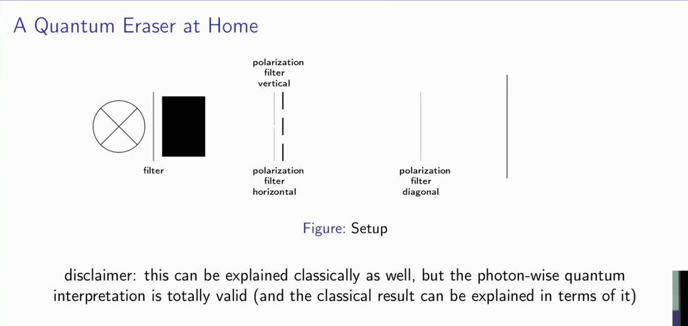

The figure shows a light source, a filter, a double slit with a vertical polarisation filter over one slit and a horizontal one over the other, a diagonal polarisation filter behind it, and a screen. A disclaimer on the slide says this can be explained classically too, but the photon-wise quantum interpretation is valid (and the classical result follows from it). The speaker said the original slide order was off ("there's a slide missing").

Encoding which-way information with the vertical and horizontal filters destroys the interference pattern, as classical optics also predicts. This slide returned at 00:38:15 (see below). No equations.

## Slide 33: Harmonic Oscillator (00:38:11)

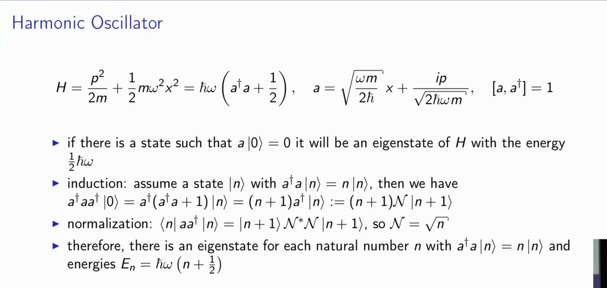

This slide appeared briefly at 00:38:11, then the eraser slide came back (below), and the harmonic oscillator was discussed from 00:38:24. It is described here once.

The harmonic oscillator can be solved exactly with creation and annihilation operators (the speaker said "destroyer"). The slide shows the Hamiltonian in terms of $a$ and $a^\dagger$ and a ladder argument. If a state with $a|0\rangle = 0$ exists, it is an eigenstate of $H$ with energy $\tfrac12\hbar\omega$. Assuming $a^\dagger a|n\rangle = n|n\rangle$, applying $a^\dagger$ gives the next state, giving one eigenstate for each natural number $n$.

$$H = \frac{p^2}{2m} + \frac{1}{2}m\omega^2 x^2 = \hbar\omega\left(a^\dagger a + \frac{1}{2}\right)$$

$$a = \sqrt{\frac{\omega m}{2\hbar}}\, x + \frac{ip}{\sqrt{2\hbar\omega m}}, \qquad [a, a^\dagger] = 1$$

$$a^\dagger a\, a^\dagger |0\rangle = a^\dagger\big(a^\dagger a + 1\big)|n\rangle = (n+1)\, a^\dagger |n\rangle := (n+1)\,\mathcal{N}\,|n+1\rangle$$

$$\langle n|\, a a^\dagger\, |n\rangle = |n+1|\,\mathcal{N}^*\mathcal{N}\,|n+1|, \quad \text{so } \mathcal{N} = \sqrt{n}$$

$$a^\dagger a\,|n\rangle = n\,|n\rangle, \qquad E_n = \hbar\omega\left(n + \frac{1}{2}\right)$$

Flags: the slide prints $|0\rangle$ on the left of the induction line where $|n\rangle$ seems meant, and gives $\mathcal{N} = \sqrt{n}$, whereas $a^\dagger|n\rangle = \sqrt{n+1}\,|n+1\rangle$ is the standard result. Both are transcribed as shown.

## Back to slide 32: A Quantum Eraser at Home (00:38:15)

Adding the diagonal polarisation filter behind the slits erases the which-way information, so the interference pattern appears again.

## Back to slide 33: Harmonic Oscillator (00:38:24)

The speaker said that if you can solve the harmonic oscillator you will get through physics exams. Using creation and annihilation operators, the ground state is found far more simply than by solving the Schrödinger equation explicitly. Equations are as in the section for Slide 33 above.

## Slide 34: Harmonic Oscillator (cont.) (00:38:59)

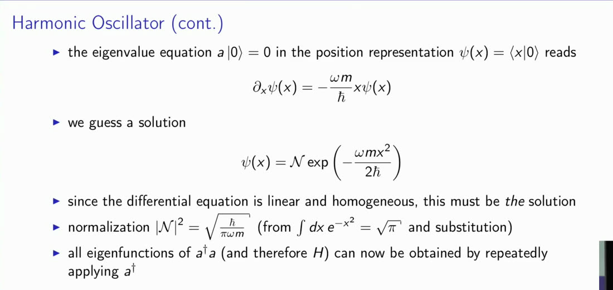

In the position representation, $a|0\rangle = 0$ becomes a first-order linear differential equation. A Gaussian is guessed as the solution, and because the equation is linear and homogeneous it is the solution (up to normalisation). All higher eigenfunctions follow by repeatedly applying $a^\dagger$.

$$\psi(x) = \langle x | 0 \rangle$$

$$\partial_x \psi(x) = -\frac{\omega m}{\hbar}\, x\, \psi(x)$$

$$\psi(x) = \mathcal{N}\exp\left(-\frac{\omega m x^2}{2\hbar}\right)$$

$$|\mathcal{N}|^2 = \sqrt{\frac{\hbar}{\pi\omega m}}, \quad \text{from } \int dx\, e^{-x^2} = \sqrt{\pi}$$

Flag: from the Gaussian integral the normalisation constant would be $|\mathcal{N}|^2 = \sqrt{\omega m / (\pi\hbar)}$, so the slide's fraction looks inverted. It is transcribed as shown.

The speaker then covered tunnelling, which has no slide in this recording. A barrier too high to cross does not mean zero penetration: the probability of finding the particle in the barrier decays exponentially. He explained it via the uncertainty relation (confining the particle to a thin region raises its momentum and energy, so it reaches further). He called "instantaneous travel through the barrier" a myth, since the particle is extended and its speed is not well defined in deep quantum regimes. The Schrödinger equation is not relativistic, so nothing in the theory stops speeds above that of light. (Spoken): inside the barrier $\psi(x) \propto e^{-\kappa x}$ with $\kappa > 0$.

$$\psi(x) \propto e^{-\kappa x}, \quad \kappa > 0$$

## Slide 35: Entanglement (00:40:33)

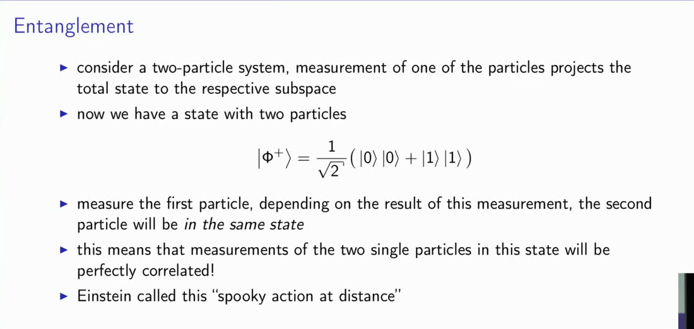

For a two-particle system, measuring one particle projects the total state onto the corresponding subspace. The example state is a superposition of both particles being $|0\rangle$ and both being $|1\rangle$. Measuring the first fixes the second, so the two are perfectly correlated. Einstein called this "spooky action at distance".

$$|\Phi^+\rangle = \frac{1}{\sqrt{2}}\Big(|0\rangle|0\rangle + |1\rangle|1\rangle\Big)$$

The speaker added that Einstein, Podolsky and Rosen intended this as an argument that quantum mechanics is absurd, but it is true. There are no hidden variables: the result is not fixed beforehand. Bell tests show experimentally that the Bell inequality, a bound for hidden-variable theories, is violated. A myth: entanglement does not carry information faster than light. It yields correlated noise at two ends, which quantum cryptography uses. The speaker also said that non-relativistic quantum mechanics has no speed limit anyway.

## Slide 36: Quantum Information (00:42:46)

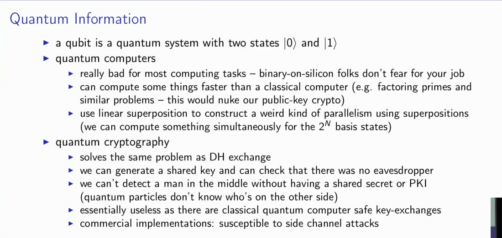

A qubit is a quantum system with states $|0\rangle$ and $|1\rangle$, and arbitrary superpositions are allowed. Quantum computers:
- are poor at most tasks (no need to fear for jobs);
- can be faster for some problems, such as factoring primes, which would break public-key crypto;
- use linear superposition for a "weird kind of parallelism" over the $2^N$ basis states.

Quantum cryptography solves the same problem as Diffie-Hellman key exchange: generate a shared key and detect an eavesdropper from measurement statistics. It cannot detect a man in the middle without a shared secret or PKI. It is essentially useless because classical quantum-safe key exchanges exist, and commercial implementations are susceptible to side-channel attacks (the speaker's example: shining light into the fibre to read the polarisation filter state).

$$|\psi\rangle = \alpha|0\rangle + \beta|1\rangle \quad \text{(spoken)}$$

$$2^N \text{ basis states}$$

## Slide 37: References (00:44:48)

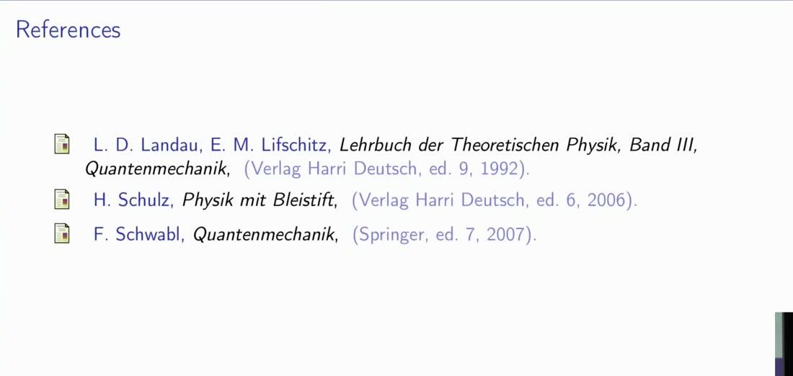

Three German textbooks:
- L. D. Landau, E. M. Lifschitz, *Lehrbuch der Theoretischen Physik, Band III, Quantenmechanik* (Verlag Harri Deutsch, 9th ed., 1992);
- H. Schulz, *Physik mit Bleistift* (Verlag Harri Deutsch, 6th ed., 2006);
- F. Schwabl, *Quantenmechanik* (Springer, 7th ed., 2007).

The speaker said the first is the hardest, to read only after the other two. The second has an accessible 20-page introduction in its last pages. The first and last are available in translation.

The rest of the recording is audience Q&A. Main points:
- **Where does the measured system end?** No full answer. Decoherence is the start of one: the measurement structure comes from interaction with an environment whose states are traced out, leaving classically randomised states. It does not settle the question, which is what the interpretation debates are about.
- **Purpose of the theory section.** Quantum mechanics cannot be understood without the mathematics; the aim was to show it is halfway accessible and where to look.
- **Is atomic randomness real?** Radioactive decay is as random as measurement. Modelling the whole system plus environment requires an exponentially growing state space (10 particles give a 1024-dimensional space), so predicting decay is, he argued, objectively impossible.
- **Quantum simulation (online question).** A main motivation for quantum computers, due to Feynman: a digital quantum computer can efficiently simulate quantum systems, which classical computers cannot because of the exploding Hilbert space. Whether scalable machines will exist is open.
- **Confirmation of hypotheses.** Experiments can make a hypothesis probable but never confirm it. His personal view: physics gives models, not ontology.
- **Interpretations (GRW question).** He does not know the GRW interpretation. He finds interpretations largely irrelevant unless they change what can be measured.
- **Is probability inherent?** If decoherence theory is true, quantum mechanics is deterministic (Everett: all outcomes occur and we see one branch). He called this philosophy rather than science for now.

## Back to slide 14: Crash Course: Complex Numbers (00:56:49)

The recording ends on the complex-numbers slide, left on screen while the speaker closes with thanks and the hope that he "didn't create more fear of quantum mechanics than I dispersed". See the first Slide 14 section for the content.
